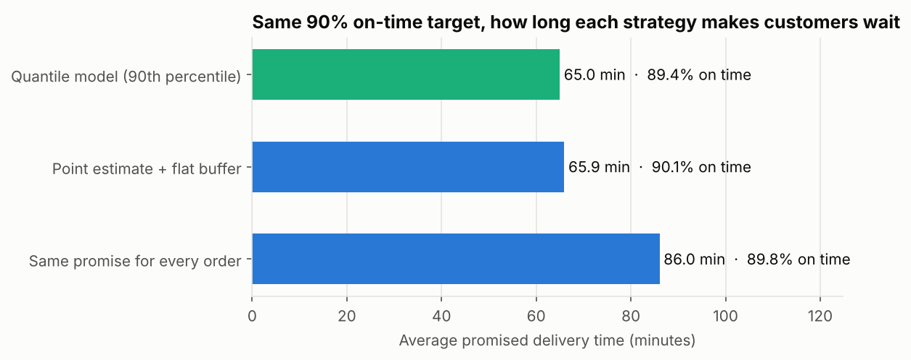
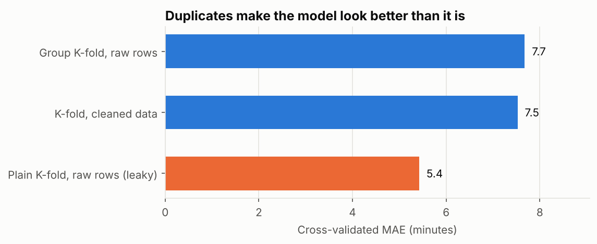
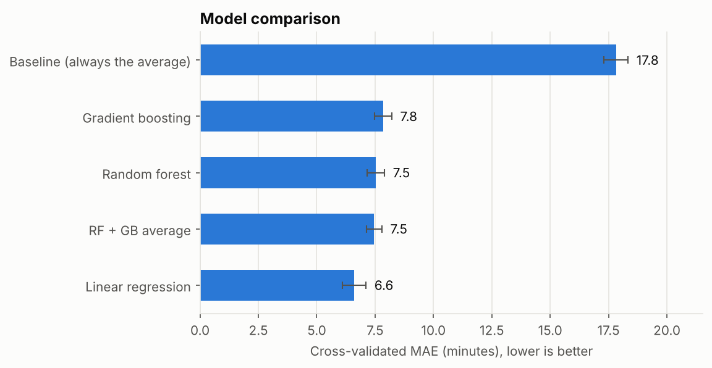
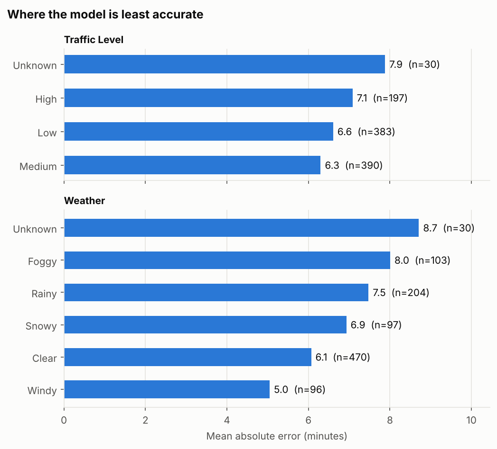
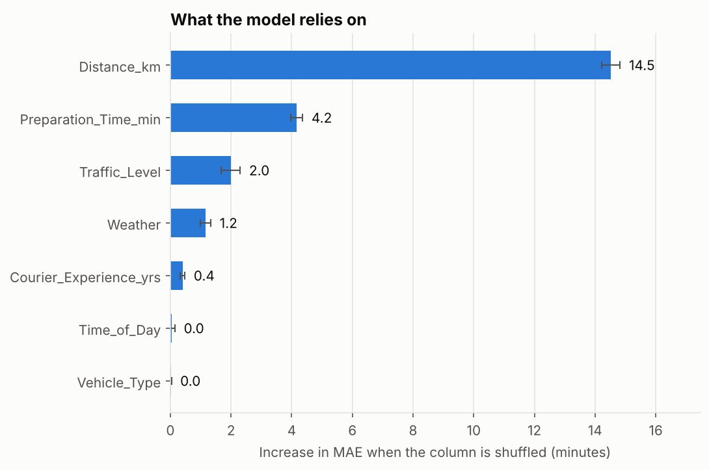

# Food delivery time: from a prediction to a promise

**How long should a delivery app promise?** This project predicts food delivery time and then turns
the prediction into a promised time that keeps 90% of orders on time. The model-based promise is
**about 20 minutes shorter** than a single promise for every order, at the same reliability.



## Results at a glance

| | |
|---|---|
| Best model | Linear regression, **6.6 min** mean absolute error (5-fold CV, repeated 3×) |
| vs. baseline | 63% lower error than always predicting the average (17.8 min) |
| vs. tree models | Beats Random Forest (7.5), gradient boosting (7.8) and their average (7.5) |
| Data leak caught | Duplicate orders would have made the model look **28% better** than it is |
| Business result | 90% on-time with an average promise of **65 min instead of 86 min** |

## The questions, in order

### 1. Is the data what it looks like?
The file has 1,663 rows but only 1,000 distinct orders: 557 exact copies, plus 106 copies with one
value blanked out. No two copies of an order disagree, so the copies are merged into one row per
order. That recovers all 106 missing delivery times and 85 blanked feature values instead of
dropping or guessing them.

### 2. How much would the duplicates have inflated the score?



Same model, same rows, only the split changes. When copies of an order land on both sides of a
fold, the model is tested on orders it has already seen and reports 5.4 minutes instead of the
honest 7.5-7.7.

### 3. Which model?



Every model is one scikit-learn pipeline (impute → one-hot encode → model) fitted inside each fold,
so nothing from the test fold leaks into preprocessing. Linear regression wins: the relationship is
mostly additive, and with 1,000 orders the tree models fit noise.

### 4. Where is it wrong, and what drives delivery time?



Errors grow in fog, rain and heavy traffic: the conditions that add delay also add uncertainty.
3.5% of orders are off by more than 20 minutes; nothing in the data explains those very long
deliveries.



Distance dominates. In the model's own units, each kilometre adds about 3 minutes, each minute of
preparation about 1 minute, high traffic about 12 minutes compared with low, and snow about 9.6
minutes compared with clear weather.

### 5. What should the app promise?
A point prediction is right on average, so about half of orders would arrive after it. Three
strategies, each calibrated on training folds only to reach 90% on time, then judged on unseen
orders:

| Strategy | On time | Average promise | Median lateness when late |
|---|---|---|---|
| Same promise for every order | 89.8% | 86.0 min | 8.9 min |
| Prediction + flat buffer (~9 min) | 90.1% | 65.9 min | 4.9 min |
| Quantile model (90th percentile) | 89.4% | 65.0 min | 1.4 min |

**Recommendation:** use the quantile model, shown as a window from the prediction to the promise
(for example "50-58 min"), with *prediction + 9 minutes* as the simple fallback. Recalibrate monthly
and track the on-time rate.

## Limitations
- 1,000 orders from a practice dataset, with no dates, locations or restaurant details. The
  results show the method, not a production-ready number.
- The long tail of very late orders is not explained by the available columns.
- Calibration assumes future orders look like these.

## Data
The dataset comes from the **KAUST Academy AI program** (Kaggle: `mohammad2012191/q1-ka-ai-2026`).
It is a modified copy of a public Kaggle dataset of 1,000 food orders: the KAUST version adds
duplicate rows and extra missing values. The CSV is not stored in this repo; see
[data/README.md](data/README.md) to download it.

## Run it

```bash
git clone https://github.com/THE-MACHINE221/delivery-time-prediction.git
cd delivery-time-prediction
pip install -r requirements.txt
# download Q1_data.csv into data/ (see data/README.md), then:
jupyter notebook notebooks/delivery_time_prediction.ipynb
```

## Structure

```
├── notebooks/delivery_time_prediction.ipynb   # the full analysis, with outputs
├── src/delivery_eta/
│   ├── data.py       # loading, audit, duplicate checks, merging copies
│   ├── modeling.py   # pipelines, cross-validation, importance, promise calibration
│   └── plots.py      # charts
├── reports/figures/  # charts used in this README
└── data/README.md    # how to download the KAUST dataset
```

## Credits
- Data: KAUST Academy AI program, based on the public Kaggle dataset
  [Food Delivery Time Prediction](https://www.kaggle.com/datasets/denkuznetz/food-delivery-time-prediction).
- Built during the KAUST Academy AI Specialization and extended independently.
